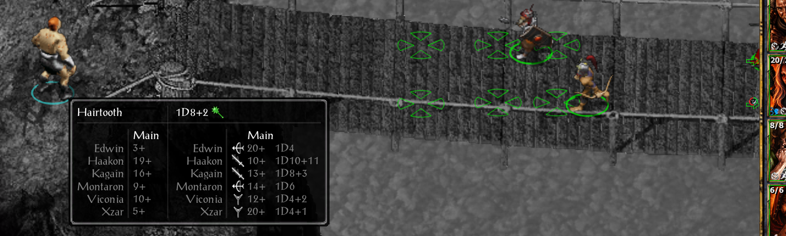
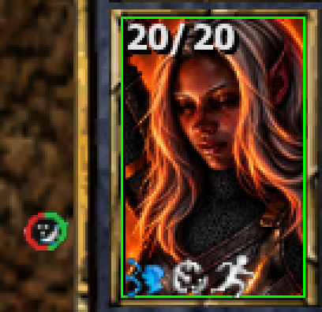
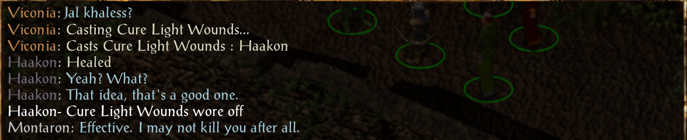

# [MOD] Battle Sense v0.1.0 – see what is really happening in a fight (requires EEex)

Baldur's Gate hides most of what decides a fight. You see a swing and a number in the log, but not what your fighter needed to roll, how far the enemy mage is from finishing a spell, or why your Sleep did nothing to half the room. For a long time it made no sense to me what was happening, so I built the tools to show it.

**Battle Sense** is a WeiDU mod for BG:EE, BG2:EE, EET and IWD:EE that puts that information on screen. It has three components, and you can install any combination of them.

**Download:** `<GitHub release link>`
**Requires:** [EEex](https://github.com/Bubb13/EEex) v1.3.1, installed first

---

## 1. Attack Info

Hover the attack cursor over a creature and a popup opens with two panels.

**The left panel is what the creature can do to you.** For each selected party member it shows the roll the creature needs to hit them. In the screenshot, Hairtooth hits Edwin on a 3 or better but needs a 19 against Haakon.

**The right panel is what you can do to the creature.** For each selected party member it shows:

- an icon for the damage type of their weapon (slashing, piercing, crushing, missile)
- the roll they need to hit, or the chance to hit as a percentage if you prefer that
- the damage of a hit, with the creature's resistance to that damage type shown behind it: `-50%` means it only takes half, `+25%` means it takes a quarter more
- extra damage the weapon applies on a hit, such as fire or poison, each with the creature's resistance to that element
- whether the creature is immune to the weapon altogether: the row turns red and says `Immune` where the resistance would be, or you can have it shown as text only

Below the creature's name, the left panel's header shows what the creature itself attacks with: its damage, damage type and any extra on-hit damage. The right panel's header lists how many stoneskins or mirror images it has left, and the spells affecting it, one per line with the time they have left in turns and rounds, such as `Haste (1,5)`.

**Timer bars in the popup.** While the creature under the cursor is busy, bars in the left panel show how far along it is:

- orange: its attack round, with white ticks at the moments it makes its attack rolls
- cyan: spell casting, with a white tick where the spell is released
- green: contingency checks
- red: modal actions such as bard song or turn undead

The same attack and casting bars appear under the names in the right panel for everyone who is attacking that creature.

**Hovering over a friend.** For party members, summons and allies the popup switches to a compact form that lists who that character is fighting: what they need to hit each opponent, and what each opponent needs to hit them. It only opens while you hold the keybind, so it stays out of the way.

Everything is configurable under Options > EEex Options > "Battle Sense: Attack Info": font size, roll or percentage, how immunities are shown, the keybinds, and each timer bar.

## 2. Timer

Bars beside the party portraits that show what each character is in the middle of:

- **Casting timer** (cyan): the cooldown before the character can cast or use an item again, with a marker at the moment the spell being cast is released
- **Attack round** (orange): how far the character is through their round, with a marker for every attack roll. The markers follow the character's weapon speed, and with a half attack (3/2, 5/2) the last marker only shows in the rounds where that attack is actually made
- **Modal action** (red) and **contingency** (green) timers
- **Resistance rings**: a small ring beside the portrait for every element the character resists, and for magic resistance. The green part of the ring is the resistance percentage

*Viconia's magic resistance, shown as a ring beside her portrait.*

Each indicator can be switched off separately under "Battle Sense: Timer".

## 3. Combat Log

Extra lines in the combat log that explain things the game leaves out:

- **Spells and conditions ending:** `Haakon- Cure Light Wounds wore off`
- **Failed saving throws:** `Gnoll- Failed save vs. Spell against Sleep`
- **Why a spell did nothing:** `Skeleton- Unaffected by Sleep: immune to sleep`
- **Why a weapon is ineffective:** `Minsc- Long Sword is ineffective against Werewolf: it requires a +1 weapon or better`

Lines are only printed when your party is involved, so the log stays readable and you learn nothing about creatures you cannot see.

---

## Installation

1. Install EEex v1.3.1.
2. Extract the zip into your game folder, so that the `BattleSense` folder and `setup-BattleSense.exe` sit next to `chitin.key`.
3. Run `setup-BattleSense.exe` and choose the components you want.
4. Start the game with `InfinityLoader.exe`, as with any EEex mod.

## Good to know

- **Attack Info and Timer replace EEex's own modules of the same name.** They are extended versions of those modules. When you install them, Battle Sense switches the EEex ones off so nothing is drawn twice. If you uninstall Battle Sense, turn them back on under EEex Options > Modules.
- **Battle Sense has its own settings.** Anything you changed for EEex's Attack Info or Timer module is not carried over.
- **The Combat Log component adds a hidden effect to every creature,** which is how it can see spells that get blocked. That effect is stored in your save games, so keep the component installed for saves made with it.
- **English only for now.** Translations can be added as a single file; see the readme.
- Battle Sense only adds files with the `ZJ` prefix to the override folder. It does not modify any file of the game, of EEex, or of another mod.

## Status

This is a first release. I have tested it on BG:EE with EEex v1.3.1; BG2:EE, EET and IWD:EE should work but have not been tried yet. Bug reports and suggestions are very welcome, here or at `<GitHub issues link>`.

## Credits

Battle Sense is built on [EEex](https://github.com/Bubb13/EEex) by Bubb. The Attack Info and Timer components started from his modules of the same name. Thank you, Bubb, for making all of this possible.
